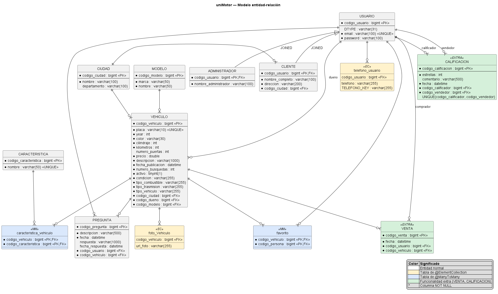

# uniMotor

> **Demo en línea:** **<https://unimotor.onrender.com/proyecto-web/>**
> (servidor gratuito: si nadie la ha abierto en los últimos 15 minutos, la primera carga tarda cerca de un minuto).
> Para entrar como cliente use uno de los [usuarios de prueba](#usuarios-de-prueba).

Portal de compra y venta de vehículos desarrollado para el curso **Análisis de Algoritmos II** de la
Universidad del Quindío. Tiene dos clientes sobre la misma capa de negocio:

- un **cliente web** (JSF + PrimeFaces) para compradores y vendedores, y
- una **aplicación de escritorio** (JavaFX) para el administrador, que se conecta de forma remota
  al EJB desplegado en el servidor.

Además expone una **API REST de solo lectura** en JSON (ver [API REST](#api-rest)).

## Contenido

1. [Arquitectura](#arquitectura)
2. [Modelo de datos](#modelo-de-datos)
3. [Requisitos previos](#requisitos-previos)
4. [Puesta en marcha](#puesta-en-marcha): base de datos, Payara, correo, carpeta de fotos, compilar y desplegar,
   aplicación de escritorio
5. [Demo publicada (Render + TomEE)](#demo-publicada-render--tomee): imagen Docker, base en TiDB Cloud y despliegue
   automático desde GitHub
6. [Usuarios de prueba](#usuarios-de-prueba)
7. [API REST](#api-rest)
8. [Pruebas](#pruebas)
9. [Documentación](#documentación)
10. [Solución de problemas](#solución-de-problemas)
11. [Estado del proyecto](#estado-del-proyecto)

## Arquitectura

Proyecto Maven multimódulo (Java 8, Java EE 8). `groupId`: `co.edu.uniquindio.unimotor`.

| Módulo | Capa | Contenido | Paquete base |
|---|---|---|---|
| `proyecto-persistencia` | Persistencia | Entidades JPA, enumeraciones, `NamedQuery` de negocio y de estadísticas, DTO (`EstadisticaDTO`, `PuntoDTO`) | `co.edu.uniquindio.unimotor.entidades`, `...dto` |
| `proyecto-negocio` | Negocio | EJB (`AdministradorEJB` con su interfaz remota, `ClienteEJB`, `VehiculoEJB`, `CorreoEJB`), `SetupEJB` (datos iniciales) y excepciones | `co.edu.uniquindio.unimotor.ejb`, `...excepciones` |
| `proyecto-web` | Presentación (web y API REST) | Aplicación JSF + PrimeFaces (cliente) y API JAX-RS | `co.edu.uniquindio.unimotor.web` |
| `proyecto-ear` | Empaquetado | Junta `proyecto-negocio` y `proyecto-web` en `proyecto-ear-0.0.1-SNAPSHOT.ear` | n/a |
| `proyecto-escritorio` | Presentación (administrador) | Aplicación JavaFX con 17 gráficos de estadísticas | `co.edu.uniquindio.unimotor.escritorio` (`app`, `controlador`, `modelo`) |
| `proyecto-pruebas` | Pruebas | JUnit 4, Arquillian (GlassFish embebido) y DBUnit con datasets JSON | `co.edu.uniquindio.unimotor.pruebas` |

Tecnologías: Java 8, Java EE 8 (EJB 3.2, JPA 2.1 con EclipseLink, JSF 2.3 con CDI, JAX-RS), PrimeFaces 8.0 (tema
`nova-light`), JavaFX 8, JavaMail, MySQL 8 (Connector/J 8.0.33), Payara Server 5.2022.5, Maven 3.9,
Arquillian y DBUnit.

## Modelo de datos

Entidades (`co.edu.uniquindio.unimotor.entidades`): `Usuario` (herencia JOINED, columna `DTYPE`), `Administrador`,
`Cliente`, `Ciudad`, `Modelo`, `Caracteristica`, `Vehiculo`, `Pregunta`, `Venta` y `Calificacion`,
más las enumeraciones `Condicion`, `TipoCombustible`, `TipoTrasmision` y `TipoVehiculo`.
Las tablas intermedias son `favorito`, `caracteristica_vehiculo`, `foto_Vehiculo` y `telefono_usuario`.

Funcionalidades extra modeladas:

- **Venta**: registra la venta de un vehículo (comprador, fecha).
- **Calificación del vendedor**: un cliente califica de 1 a 5 estrellas (con comentario) a un vendedor;
  no se puede calificar dos veces al mismo vendedor.



## Requisitos previos

| Herramienta | Versión |
|---|---|
| JDK con JavaFX | 8 (por ejemplo Azul Zulu 8 FX); **no** use Java 17 (ver [Solución de problemas](#solución-de-problemas)) |
| Maven | 3.9 |
| Payara Server | 5.2022.5 (rama 5, compatible con Java 8) |
| Docker | para MySQL 8 y Mailpit (Docker Desktop en Windows) |
| IntelliJ IDEA | opcional (el repositorio incluye configuraciones en `.run/`) |

Variables de entorno recomendadas: `JAVA_HOME` (JDK 8 con JavaFX), `MAVEN_HOME` y `PAYARA_HOME`
(carpeta de Payara), con sus `bin` en el `Path`. Los comandos de este documento son para `cmd` de Windows.

## Puesta en marcha

### 1. Base de datos MySQL

```bat
docker run -d --name unimotor-mysql --restart unless-stopped -p 3306:3306 ^
  -e MYSQL_ROOT_PASSWORD=12345 -e MYSQL_DATABASE=unimotor ^
  -v unimotor-mysql-data:/var/lib/mysql mysql:8.0 ^
  --default-authentication-plugin=mysql_native_password ^
  --character-set-server=utf8mb4 --collation-server=utf8mb4_unicode_ci

docker exec unimotor-mysql mysql -uroot -p12345 -e "CREATE DATABASE IF NOT EXISTS prueba CHARACTER SET utf8mb4;"
```

`unimotor` la usa el servidor y `prueba` las pruebas automáticas. Las credenciales (`root` / `12345`) son solo
para desarrollo local. Consola SQL: `docker exec -it unimotor-mysql mysql -uroot -p12345 unimotor`.

El servidor crea las tablas si no existen (`schema-generation = create`) pero no las actualiza: si cambia una
entidad, recree la base:

```bat
docker exec unimotor-mysql mysql -uroot -p12345 -e "DROP DATABASE unimotor; CREATE DATABASE unimotor CHARACTER SET utf8mb4;"
```

y vuelva a desplegar. Los nombres de tabla distinguen mayúsculas (MySQL en Linux): las entidades generan tablas
en mayúsculas (`USUARIO`, `VEHICULO`...) y las intermedias con el nombre declarado (`favorito`,
`caracteristica_vehiculo`, `foto_Vehiculo`, `telefono_usuario`).

### 2. Payara y recurso JDBC

1. Copie `mysql-connector-j-8.0.33.jar` en `%PAYARA_HOME%\glassfish\domains\domain1\lib`.
2. Haga que Payara use el JDK 8: agregue `set AS_JAVA=<ruta del JDK 8>` al final de
   `%PAYARA_HOME%\glassfish\config\asenv.bat`.
3. Inicie el dominio y cree el pool y el recurso JDBC (el nombre JNDI `jdbc/prueba` es el que
   declara `proyecto-persistencia/src/main/resources/META-INF/persistence.xml`):

```bat
asadmin start-domain domain1

asadmin create-jdbc-connection-pool --datasourceclassname com.mysql.cj.jdbc.MysqlDataSource ^
  --restype javax.sql.DataSource ^
  --property "user=root:password=12345:serverName=localhost:portNumber=3306:databaseName=unimotor:useSSL=false:allowPublicKeyRetrieval=true:serverTimezone=America/Bogota:characterEncoding=UTF-8" ^
  mysql_unimotor_pool

asadmin create-jdbc-resource --connectionpoolid mysql_unimotor_pool jdbc/prueba

asadmin ping-connection-pool mysql_unimotor_pool
```

> Los datos de conexión van como propiedades separadas del `MysqlDataSource` (`serverName`, `portNumber`,
> `databaseName`...) en lugar de una URL, porque en `cmd` el `&` de la URL rompe el comando `asadmin`.

La consola de administración queda en <http://localhost:4848> (sin contraseña en la configuración por defecto,
solo para desarrollo local).

Con el contenedor y Payara ya configurados, el día a día se resume en:

```bat
scripts\iniciar-entorno.bat     :: inicia MySQL (Docker) y Payara
scripts\desplegar.bat           :: compila y despliega el EAR
scripts\detener-entorno.bat     :: detiene Payara y MySQL
```

Los scripts usan `PAYARA_HOME` (si no está definida, asumen `C:\Users\cfbas\dev\payara5`; edítelos o defina la variable).

### 3. Correo (JavaMail)

El envío de correos (recuperación de contraseña, avisos de preguntas y de ventas) usa el recurso JNDI
`mail/unimotor`. En desarrollo se usa [Mailpit](https://github.com/axllent/mailpit) en Docker, que recibe los
correos sin entregarlos a nadie (bandeja en <http://localhost:8025>):

```bat
docker run -d --name unimotor-mailpit --restart unless-stopped -p 1025:1025 -p 8025:8025 axllent/mailpit
asadmin create-javamail-resource --mailhost localhost --mailuser unimotor --fromaddress no-responder@unimotor.local --property mail.smtp.port=1025 mail/unimotor
```

Para usar **Gmail**, cree una contraseña de aplicación en la cuenta de Google, borre el recurso y créelo de nuevo:

```bat
asadmin delete-javamail-resource mail/unimotor
asadmin create-javamail-resource --mailhost smtp.gmail.com --mailuser su.cuenta@gmail.com --fromaddress su.cuenta@gmail.com ^
  --property "mail.smtp.port=587:mail.smtp.auth=true:mail.smtp.starttls.enable=true:mail.smtp.password=CONTRASENA_DE_APLICACION" mail/unimotor
```

En `asadmin`, los caracteres `:` y `=` dentro de los valores de `--property` se escapan con `\`. El recurso se lista con
`asadmin list-javamail-resources`.

Si el recurso `mail/unimotor` no existe, el sistema funciona en **modo simulado**: el correo solo se registra en el
log del servidor (`[Correo simulado]`).

### 4. Carpeta de fotos

La web guarda y sirve las fotos de los vehículos desde una carpeta del servidor, por defecto
`%USERPROFILE%\unimotor\fotos` (`${user.home}/unimotor/fotos`). Para cambiarla, defina la propiedad JVM
`unimotor.fotos.carpeta` y reinicie Payara, o la variable de entorno `UNIMOTOR_FOTOS`:

```bat
asadmin create-jvm-options "-Dunimotor.fotos.carpeta=C\:/ruta/fotos"
asadmin restart-domain domain1
```

Esa carpeta solo guarda las fotos que suben los clientes (`http://localhost:8080/proyecto-web/fotos/<nombre>`).
Las fotos de los **datos de demostración** no se copian al proyecto: son enlaces a Wikimedia Commons, elegidas por
modelo (cada vehículo muestra fotos de su mismo modelo) y con licencia libre. Están en `FotosDemo` (`proyecto-negocio`,
paquete `ejb.demo`); el detalle del vehículo muestra bajo cada una su autor, su licencia y el enlace a su página, y la
lista completa de créditos está en [`docs/CREDITOS_FOTOS.md`](docs/CREDITOS_FOTOS.md). Para verlas hace falta conexión a
internet; sin ella se muestra la imagen "sin foto".

### 5. Compilar y desplegar el EAR

Opción rápida: `scripts\desplegar.bat` (ejecuta `mvn -B clean install -DskipTests` y luego
`asadmin deploy --name proyecto-ear --force=true` sobre el `.ear`). Equivale a hacer a mano:

```bat
mvn clean install -DskipTests
asadmin deploy --name proyecto-ear --force=true proyecto-ear\target\proyecto-ear-0.0.1-SNAPSHOT.ear
```

Desde IntelliJ, la configuración **Compilar todo (mvn install)** (`.run/`) hace el `clean install` sin pruebas;
después se despliega con el segundo comando.

- Aplicación web: <http://localhost:8080/proyecto-web/>
- Consola de administración de Payara: <http://localhost:4848>
- Comandos útiles: `asadmin list-applications`, `asadmin undeploy proyecto-ear`; el log está en
  `%PAYARA_HOME%\glassfish\domains\domain1\logs\server.log`.
- Las ciudades se cargan al desplegar desde api-colombia.com, con respaldo en `ciudades-colombia.json`.

**Datos de demostración:** `SetupEJB` solo carga datos si la tabla de usuarios está vacía. Crea los usuarios
iniciales (ver [Usuarios de prueba](#usuarios-de-prueba)) y llama además a `GeneradorDatosDemo` (paquete
`co.edu.uniquindio.unimotor.ejb.demo`), que crea unos 60 clientes, 400 vehículos, 800 preguntas, 100 ventas,
60 calificaciones y 150 favoritos. Los datos salen de listas reales (`CatalogoDemo`: nombres y apellidos
colombianos, 24 ciudades, unos 60 modelos vendidos en Colombia), respetan las reglas del negocio y, como usan una
semilla fija, son los mismos en cada despliegue. Cada vehículo recibe 5 fotos distintas de su tipo
(`RepartidorFotos`). Para ver datos nuevos de `SetupEJB`, recree la base `unimotor` y redespliegue.

### 6. Aplicación de escritorio

El escritorio se conecta al servidor por **EJB remoto**: `AdministradorDelegado` busca por JNDI
`AdministradorEJBRemote.JNDI` (`java:global/proyecto-ear/proyecto-negocio/AdministradorEJB!co.edu.uniquindio.unimotor.ejb.AdministradorEJBRemote`).
El servidor se elige con la propiedad `-Dunimotor.servidor`:

| Valor | Servidor | Cómo se conecta |
|---|---|---|
| `iiop` | Payara (esta guía) | IIOP con el cliente de Payara (`payara-embedded-all`, ámbito `provided`), en `localhost:3700`; se cambia con `-Dorg.omg.CORBA.ORBInitialHost` y `-Dorg.omg.CORBA.ORBInitialPort` |
| una URL HTTP(S) (por defecto `http://localhost:8080/tomee/ejb`) | TomEE (la [demo publicada](#demo-publicada-render--tomee) o `scripts\demo-docker.bat`) | HTTP con el cliente de TomEE (`openejb-client`); para la demo en Render: `https://<servicio>.onrender.com/tomee/ejb` |

Con Payara arriba y el EAR desplegado, ejecute la clase `co.edu.uniquindio.unimotor.escritorio.app.Aplicacion`
del módulo `proyecto-escritorio` con el JDK 8 con JavaFX. La forma más simple es en IntelliJ: configuración
**Escritorio (Administrador)** (`.run/`, con `-Dunimotor.servidor=iiop`), que incluye las dependencias `provided`
necesarias para el cliente remoto. Para TomEE en local está **Escritorio (TomEE local)** y para la [demo publicada](#demo-publicada-render--tomee),
**Escritorio (Render)** (`-Dunimotor.servidor=https://unimotor.onrender.com/tomee/ejb`).
Si cambió el negocio, antes ejecute `scripts\desplegar.bat` (el escritorio usa el JAR de `proyecto-negocio` del
repositorio local de Maven).

- Inicie sesión con un administrador; los clientes no pueden entrar.
- "¿Olvidó su contraseña?" envía una contraseña temporal al correo del administrador.
- La ventana principal muestra 17 gráficos de estadísticas (pastel, barras, barras apiladas, líneas, áreas,
  dispersión y burbujas) con botones para refrescar los datos y cerrar sesión.
- Si el servidor no está en ejecución, la aplicación lo indica con un mensaje de error en unos 2 segundos.

## Demo publicada (Render + TomEE)

Además de Payara, el EAR se puede desplegar sin cambios en **Apache TomEE 8 Plume** (Java EE 8 con EclipseLink y
Mojarra, como Payara, pero con mucha menos memoria). Así se publica la demo gratuita que cualquiera puede abrir en **<https://unimotor.onrender.com/proyecto-web/>**:

| Pieza | Servicio | Para qué |
|---|---|---|
| Aplicación (web, API y EJB remoto del escritorio) | [Render](https://render.com) (plan gratuito, Docker) | Se conecta al repositorio de GitHub y despliega solo en cada push |
| Base de datos compatible con MySQL | [TiDB Cloud](https://tidbcloud.com) (plan *Starter*, gratuito y sin tarjeta) | Guarda los datos; `SetupEJB` la llena en el primer arranque |

### Archivos

- [`Dockerfile`](Dockerfile): compila el EAR con Maven y JDK 8 (`-pl proyecto-ear -am`) y lo copia a la imagen
  `tomee:8.0.16-jre8-Temurin-plume`, con el driver de MySQL.
- [`despliegue/tomee/iniciar.sh`](despliegue/tomee/iniciar.sh): al arrancar el contenedor genera `conf/tomee.xml`
  con los recursos `jdbc/prueba` y `mail/unimotor` a partir de variables de entorno, escucha en el puerto `PORT` y
  limita la memoria de Java a los 512 MB del plan gratuito.
- [`despliegue/tomee/`](despliegue/tomee/): `system.properties.extra` (EJB remotos por HTTP en `/tomee/ejb` para el
  escritorio, con lista blanca de clases serializables), `context.xml` (JSF en modo `Production` solo en la imagen) y
  `ROOT/index.html` (redirige `/` a `/proyecto-web/`).
- [`render.yaml`](render.yaml): Blueprint de Render (servicio web gratuito con Docker, comprobación de salud en
  `/proyecto-web/api/marcas` y las variables de entorno).

### Variables de entorno

| Variable | Obligatoria | Valor |
|---|---|---|
| `DB_HOST`, `DB_USER`, `DB_PASSWORD` | sí | Datos de conexión de MySQL (en TiDB Cloud: botón *Connect*; el usuario lleva prefijo, p. ej. `xxxx.root`) |
| `DB_PORT`, `DB_NAME` | no | Puerto (`3306`; en TiDB Cloud `4000`) y base de datos (`unimotor`) |
| `DB_SSL_MODE` | no | `REQUIRED` por defecto (TiDB Cloud exige SSL); `DISABLED` para un MySQL local |
| `DB_URL` | no | URL JDBC completa; si está, reemplaza a host, puerto, base y SSL |
| `MAIL_HOST`, `MAIL_PORT` | no | Servidor SMTP (puerto `587` por defecto). **Sin `MAIL_HOST` los correos se simulan** y se escriben en el log (así está la demo en Render) |
| `MAIL_USER`, `MAIL_PASSWORD` | no | Usuario y contraseña SMTP (si hay usuario, se autentica) |
| `MAIL_FROM`, `MAIL_STARTTLS` | no | Remitente (`no-responder@unimotor.local`) y STARTTLS (`true`) |
| `PORT`, `JAVA_XMX` | no | Puerto HTTP (8080; Render lo define solo) y heap de Java (`320m`) |
| `TX_TIMEOUT` | no | Tiempo máximo de una transacción (`1 hour`; el de TomEE es `10 minutes`). La primera carga de datos de demostración contra una base lejana puede tardar más de 10 minutos |

### Publicarla

1. **TiDB Cloud:** entrar con GitHub → *Create Resource* → plan *Starter*, AWS `us-east-1` (la región de Render)
   y límite de gasto 0. En *Connect* (*Public*, *General*) generar la contraseña y anotar host, puerto y usuario;
   en *SQL Editor* ejecutar `CREATE DATABASE unimotor;`. EclipseLink crea las tablas en el primer arranque.
2. **Render:** entrar con la cuenta de GitHub → *New* → *Blueprint* → elegir este repositorio. Render lee
   `render.yaml` y pide las variables marcadas con `sync: false` (`DB_HOST`, `DB_USER` y `DB_PASSWORD`).
3. Esperar a que termine el primer despliegue (compila el EAR y, como la base está vacía, `SetupEJB` carga las
   ciudades y los datos de demostración). La demo queda en `https://<servicio>.onrender.com/proyecto-web/`.

Desde entonces, cada push a la rama del servicio vuelve a desplegar la aplicación.

Limitaciones del plan gratuito de Render:

- el servicio se duerme tras 15 minutos sin visitas y la primera visita tarda cerca de un minuto en despertarlo;
- el disco del contenedor no se conserva: las fotos que suban los usuarios se pierden al redesplegar o reiniciar
  (las de los datos de demostración son enlaces a Wikimedia Commons y no se pierden);
- bloquea el SMTP saliente (puertos 25, 465 y 587), así que la demo no define `MAIL_HOST` y los correos (pregunta,
  compra, recuperación de contraseña) se simulan: la acción se completa y el correo solo se escribe en el log. Con un
  servidor propio o un plan de pago basta con definir las variables `MAIL_*`.

### Probarla en local con Docker

`scripts\demo-docker.bat` construye la imagen y la ejecuta con 512 MB contra el MySQL y el Mailpit de Docker (con
Payara detenido, porque usa el puerto 8080). El escritorio se conecta con la configuración **Escritorio (TomEE local)**.

## Usuarios de prueba

Los crea `SetupEJB`:

| Rol | Email | Contraseña | Dónde entra |
|---|---|---|---|
| Administrador | `cristia@proyecto.com` | `123` | solo escritorio |
| Administrador | `profesor@proyecto.com` | `4444` | solo escritorio |
| Cliente | `usuario1@servidor.com`, `usuario2@servidor.com`, `usuario3@servidor.com` | `12345` | web |

Los unos 60 clientes de demostración también usan `12345` (el email sale del nombre, por ejemplo
`oscar.patino@outlook.es`; se consultan con `SELECT email FROM USUARIO`).

## API REST

La aplicación web expone una API de **solo lectura** en JSON (JAX-RS) sobre los vehículos publicados y los
catálogos. URL base: `http://localhost:8080/proyecto-web/api`

| Método | Ruta | Parámetros (todos opcionales salvo indicación) | Respuesta |
|---|---|---|---|
| GET | `/vehiculos` | `tipo`, `marca`, `condicion`, `precioMin`, `precioMax`, `anioMin`, `anioMax`, `limite` (1 a 500), `pagina` (desde 1) | Lista de vehículos (resumen) activos y no vendidos, los más recientes primero; cabecera `X-Total-Count` con el total antes de paginar |
| GET | `/vehiculos/{id}` | `id`: entero positivo | Detalle del vehículo (también si está inactivo o vendido, con `activo=false` o `vendido=true`) |
| GET | `/vehiculos/top` | `condicion` (obligatoria): `NUEVO` o `USADO` | Los 10 vehículos activos más buscados de esa condición |
| GET | `/ciudades` | `nombre`: texto contenido en el nombre, sin distinguir mayúsculas ni tildes | Lista de ciudades (`id`, `nombre`, `departamento`) |
| GET | `/caracteristicas` | n/a | Lista de características (`id`, `nombre`) |
| GET | `/modelos` | `marca` | Lista de modelos (`id`, `marca`, `nombre`) |
| GET | `/marcas` | n/a | Lista de marcas (texto) |

`tipo` y `condicion` usan el nombre de la enumeración (por ejemplo `CARRO`, `MOTOCICLETA`, `NUEVO`) sin
distinguir mayúsculas; `marca` tampoco distingue mayúsculas. Sin `limite` ni `pagina` se devuelven todos los
resultados; con `pagina` y sin `limite` el tamaño de página es 500.

### Errores

Los errores devuelven el estado HTTP y un cuerpo JSON con este formato:

```json
{ "estado": 400, "error": "Solicitud inválida", "mensaje": "El parámetro precioMin debe ser un número." }
```

| Estado | Cuándo |
|---|---|
| 400 | Parámetro mal formado (no numérico, negativo, enumeración inexistente, rango invertido, `limite` o `pagina` fuera de rango), `condicion` ausente en `/vehiculos/top`, o id no numérico o menor que 1 (incluido `/vehiculos/abc`) |
| 404 | El vehículo no existe o la ruta no existe |
| 405 | Método distinto de GET (la API es de solo lectura) |
| 500 | Error inesperado del servidor |

### Ejemplos

```bat
curl "http://localhost:8080/proyecto-web/api/vehiculos?tipo=carro&marca=Mazda&precioMax=80000000&limite=5"
curl "http://localhost:8080/proyecto-web/api/vehiculos/2"
curl "http://localhost:8080/proyecto-web/api/vehiculos/top?condicion=USADO"
curl "http://localhost:8080/proyecto-web/api/ciudades?nombre=armenia"
curl "http://localhost:8080/proyecto-web/api/modelos?marca=Renault"
```

Vehículo (detalle, `GET /vehiculos/2`, con los datos de demostración):

```json
{
  "id": 2,
  "titulo": "Audi A1 2018",
  "marca": "Audi",
  "modelo": "A1",
  "anio": 2018,
  "precio": 26000000.0,
  "kilometros": 0,
  "tipo": "CARRO",
  "condicion": "NUEVO",
  "combustible": "GASOLINA",
  "transmision": "MECANICO",
  "ciudad": "Armenia (Quindío)",
  "fotoPrincipal": "/fotos/carro-12.jpg",
  "numeroBusquedas": 120,
  "activo": true,
  "vendido": false,
  "fechaPublicacion": "2026-10-08",
  "url": "/detalleVehiculo.xhtml?id=2",
  "descripcion": "Bolido perfectamente cuidado, con menos de mil kilometros, practicamente nuevo",
  "color": "Negro",
  "cilindraje": 2000,
  "numeroPuertas": 2,
  "placaTerminacion": "2",
  "fotos": ["/fotos/carro-12.jpg", "/fotos/carro-11.jpg", "/fotos/carro-09.jpg"],
  "caracteristicas": ["Aire acondicionado", "Bluetooth", "Sunroof"],
  "vendedor": { "nombre": "Hector R.", "ciudad": "Armenia (Quindío)" },
  "numeroPreguntas": 1
}
```

La lista (`GET /vehiculos`) devuelve los mismos campos hasta `url` (sin los del detalle).

Notas:

- Es solo lectura (GET) y no requiere autenticación.
- No expone datos personales: el vendedor se muestra con el nombre y la inicial del apellido, y de la placa solo
  la terminación.
- No altera los contadores: a diferencia de la búsqueda y el detalle de la web, la API no suma búsquedas ni visitas
  (por eso filtra en memoria y no usa `buscarVehiculos` ni `registrarVisita`).
- Las rutas de las fotos y de `url` son relativas al contexto de la aplicación (`/proyecto-web/`).

## Pruebas

```bat
cd proyecto-pruebas
mvn test
```

- La suite tiene 367 pruebas (~11 min):
  - persistencia: CRUD de las 10 entidades y una prueba por cada `NamedQuery` (`EntidadTest`, `UsuarioCatalogoTest`,
    `VehiculoTest`, `ConsultasTest`);
  - negocio: `ClienteNegocioTest` (cliente: usuarios, vehículos, búsqueda, favoritos, preguntas, catálogos),
    `ExtrasNegocioTest` (venta y calificación del vendedor) y `AdministradorNegocioTest` (login, recuperar contraseña y estadísticas);
  - validaciones y servicios: `ClienteValidacionTest`, `VehiculoPreguntaValidacionTest` y `ServiciosNegocioTest`
    (correo, plantillas de correo, ciudades, casos límite de ventas y calificaciones).
- En las pruebas de negocio el correo funciona en **modo simulado** (el GlassFish embebido no tiene `mail/unimotor`).
- Cada prueba carga los datasets JSON de `src/test/resources` en la base **`prueba`** y hace rollback.
- Requieren el contenedor `unimotor-mysql` en ejecución. **No** hay que apagar Payara: el GlassFish
  embebido de Arquillian usa puertos propios (18080, 18181, 14848, etc., definidos en `domain-test.xml`
  y `arquillian.xml`).
- Configuración de DBUnit necesaria: `schema=prueba` en `arquillian.xml` y `databaseTerm=SCHEMA`
  en la URL JDBC de `sun-resources.xml`; sin ellas DBUnit ve las tablas de todas las bases y falla con
  `AmbiguousTableNameException`.
- Para una sola clase: `mvn test -Dtest=ConsultasTest`. No ejecute dos `mvn test` a la vez
  (comparten puertos y base).


## Documentación

- Javadoc: `mvn javadoc:javadoc` (la configuración está en el `pom.xml` padre; el HTML queda en
  `proyecto-*/target/site/apidocs/index.html`). Para las pruebas: `cd proyecto-pruebas && mvn javadoc:test-javadoc`.
- Diagrama entidad-relación: [`docs/diagrama-er.png`](docs/diagrama-er.png) (también `.svg`; fuente PlantUML en
  `docs/diagrama-er.puml`, instrucciones para regenerarlo en [`docs/README.md`](docs/README.md)).

## Solución de problemas

- **Java 17 en lugar de 8:** las pruebas Arquillian fallan todas con `ArquillianServletRunner not found` (en el log:
  `Unsupported class file major version 61`). Use el JDK 8 con JavaFX en `JAVA_HOME`, en `AS_JAVA` de Payara y, en
  IntelliJ, como SDK del proyecto (*Language level* 8) y del *Maven Runner*.
- **`AmbiguousTableNameException` en las pruebas:** DBUnit ve las tablas de todas las bases del servidor. Hacen falta
  `schema=prueba` en `arquillian.xml` y `databaseTerm=SCHEMA` en la URL JDBC de `sun-resources.xml` (ya incluidos).
- **Todas las pruebas fallan con `NoSuchColumnException`:** cambió una entidad y la base `prueba` quedó desactualizada;
  recréela (solo contiene datos de DBUnit).
- **Puertos ocupados:** la web usa 8080, la administración 4848, el EJB remoto (IIOP) 3700, MySQL 3306 y Mailpit
  1025 y 8025. Las pruebas usan puertos propios (18080, 18181, 14848...), por lo que no hay que apagar Payara.
- **El escritorio dice que no puede conectar:** con Payara, compruebe que está arriba, que el EAR está desplegado
  (`asadmin list-applications`), que el puerto 3700 es accesible y que se ejecuta con `-Dunimotor.servidor=iiop`;
  con TomEE, que `-Dunimotor.servidor` apunte a `http(s)://<servidor>/tomee/ejb`. En Render, si el servicio estaba
  dormido, abra antes la web para despertarlo.
- **La web da error 500 o falla la conexión a la base:** revise `asadmin ping-connection-pool mysql_unimotor_pool`
  y que el contenedor `unimotor-mysql` esté en marcha (Docker Desktop abierto).
- **Cambié una entidad y falla el despliegue o faltan columnas:** el servidor no actualiza tablas existentes;
  recree la base `unimotor`.
- **No llegan correos:** sin el recurso `mail/unimotor` el envío es simulado (solo log). Con Mailpit, abra
  <http://localhost:8025>.
- **Tema de PrimeFaces inexistente (500 por `theme.css`):** con PrimeFaces 8.0 solo existen nova-light/dark/colored,
  luna-amber/blue/green/pink, omega y aristo.
- **Aviso de Chrome "cambia la contraseña"** al iniciar sesión con `12345`: lo genera el gestor de contraseñas del
  navegador, no la aplicación.
- **Redespliegue:** una `NoSuchFileException` en nivel INFO sobre `generated\ejb\proyecto-ear` es inofensiva.

## Estado del proyecto

- **Entrega 1 (persistencia)**: completa: entidades, `NamedQuery`, datasets JSON y pruebas en verde.
- **Entrega 2 (negocio y escritorio)**: completa: EJB con todos los requisitos (incluidas las funcionalidades
  extra), correo, API de ciudades, aplicación de escritorio con 17 gráficos y 367 pruebas en verde.
- **Entrega 3 (presentación web)**: completa. Incluye la configuración del módulo web (JSF 2.3 con CDI,
  PrimeFaces 8 con el tema `nova-light`, estilos propios y carpeta de fotos servida en `/fotos/*`) y la plantilla
  común con el menú que cambia según haya sesión, la estructura de páginas (públicas y `usuario/`) y las páginas
  de error (404, 500 y sesión expirada). Los clientes ya pueden registrarse (con las ciudades de la API y varios
  teléfonos), iniciar y cerrar sesión y recuperar la contraseña por correo; las páginas de `usuario/` exigen sesión.
  La página principal tiene el buscador (tipo, marca, rango de precio y de año) y los 10 vehículos más buscados
  nuevos y usados; los resultados se pueden refinar por características, combustible, transmisión, condición y
  kilometraje, ordenar y ver en cuadrícula o en lista. El detalle de cada vehículo muestra la galería de fotos, la
  ficha técnica, los datos del vendedor y las preguntas con sus respuestas; con sesión se puede preguntar (el
  vendedor recibe un correo) y guardar en favoritos, y cualquiera puede compartirlo en Facebook o Twitter.
  El área del cliente permite editar el perfil, cambiar la contraseña y eliminar la cuenta; publicar y editar
  vehículos con sus fotos; gestionar las publicaciones (desactivar, eliminar y marcar como vendido, con correo al
  comprador); ver y quitar favoritos; responder las preguntas recibidas, y calificar al vendedor desde "Mis compras".
  Además, la aplicación expone una API REST de solo lectura en JSON (`/proyecto-web/api/vehiculos` y los catálogos;
  ver la sección "API REST").
  La demo completa (registro, publicar, buscar, preguntar, responder, favorito, compartir, vender y calificar) se
  probó de punta a punta, y las estadísticas del escritorio reflejan esa actividad. El guion de la sustentación está
  en [`docs/GUION_SUSTENTACION.md`](docs/GUION_SUSTENTACION.md).
  El EAR también se despliega en TomEE 8 para publicar una demo gratuita en Render (ver
  [Demo publicada](#demo-publicada-render--tomee)).
  Para probar: `usuario1@servidor.com` / `12345` (los administradores entran solo por la aplicación de escritorio).
